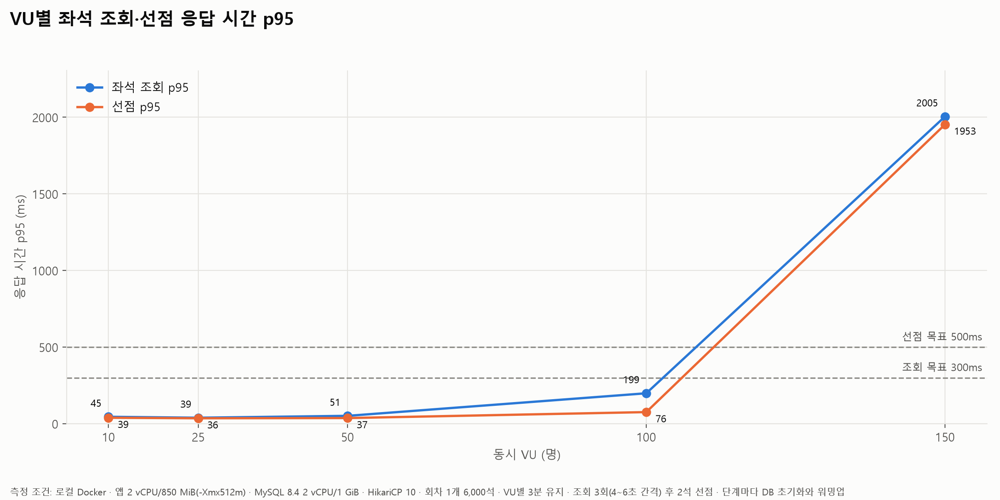
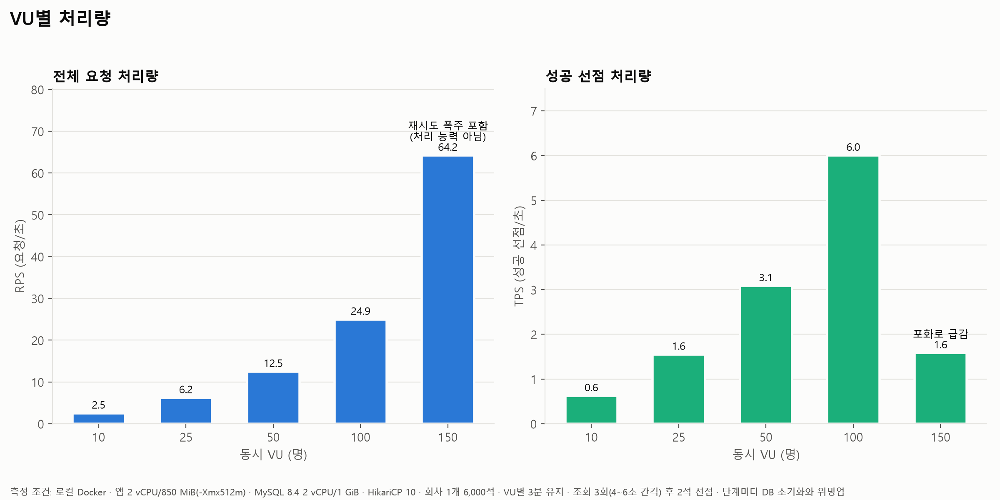
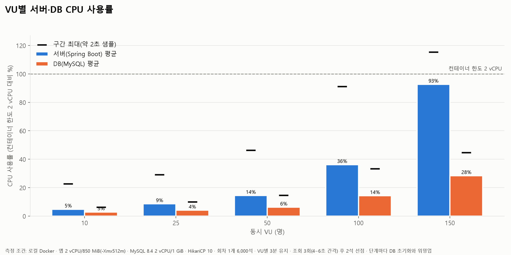
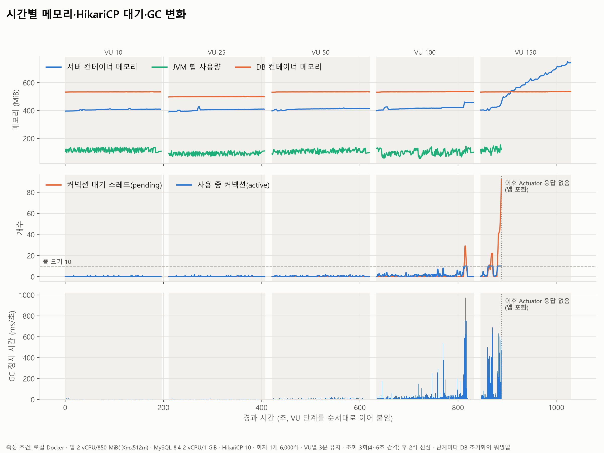
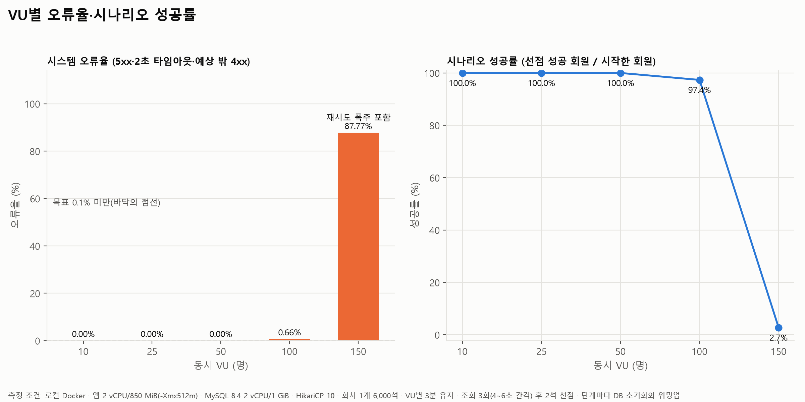
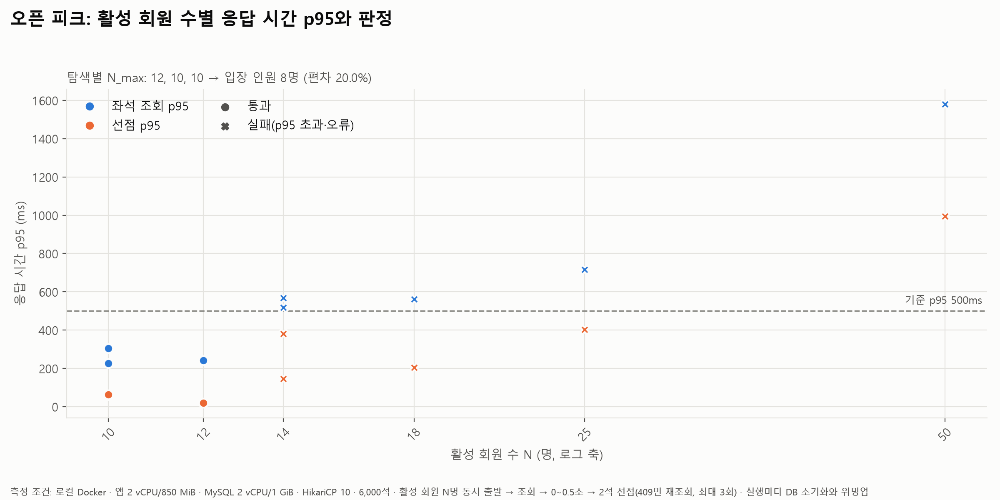

# 좌석 조회 + 선점 혼합 부하 테스트 보고서

측정일 2026-10-31. 모든 수치는 `perf/run.py`로 실제 측정한 값이며, 추정·가설은 그렇게 표시했다.

## 요약

| 질문 | 답 |
|---|---|
| 정상 부하에서 품질 목표를 만족한 최대 측정 VU | **VU 50** (스펙 기준: 조회 p95 300ms·선점 p95 500ms·오류율 0.1% 미만, ADR 0017 기준: p95 500ms·오류 0건 모두 통과). VU 100은 p95는 통과했지만 2초 타임아웃 32건(0.66%)으로 실패 |
| 오픈 피크 N_max (동시 출발 활성 회원) | **12 / 10 / 10명** (탐색 3회) → 편차 20% → **입장 인원 8명** |
| 정합성 | 모든 실행에서 위반 0 (좌석 중복 점유 0, 회원 중복 선점 0) |
| 가장 먼저 무너지는 곳 | **좌석 조회.** DB 쿼리는 3~7ms인데 서버 쪽이 느리다: 6,000석 전체 응답(437KB) → 객체 대량 생성 → Serial GC 정지 + 트랜잭션 안의 매핑 작업 동안 커넥션 점유(평균 315ms) → 커넥션 풀 고갈 |
| 측정 중 발견해 고친 문제 | 시드 직후 테이블 통계가 `n_rows=0`이라 선점의 좌석 락 쿼리가 전체 스캔 → 선점끼리 직렬화. `ANALYZE TABLE`로 해결(5절) |

## 1. 측정 환경

| 항목 | 값 |
|---|---|
| 앱 | Spring Boot 4, 컨테이너 2 vCPU / 850 MiB(스왑 없음), `-Xmx512m`, `perf` 프로파일 |
| DB | MySQL 8.4, 컨테이너 2 vCPU / 1 GiB(스왑 없음), 버퍼 풀 768M, `max-connections=66` |
| 커넥션 풀 | HikariCP 기본값 10 |
| 부하 발생기 | k6 v2.2.0, 같은 PC(8코어)에서 실행 |
| 데이터 | 회원 10,000명, 회차 2개 × 6,000석(회차 1: 측정용, 회차 2: 워밍업용) |
| 초기화 | 실행마다 DB 볼륨 삭제 → 스키마·시드 재적재 → `ANALYZE TABLE` → 워밍업(회차 2에 조회·선점 800회) |

로컬 결과는 개선 전후 비교와 병목 탐색용이다(ADR 0016). CPU 종류, t3 CPU 크레딧, EC2↔RDS 네트워크 지연, 스토리지 IOPS는 재현하지 않는다.

## 2. 시나리오

두 시나리오 모두 **선점에 성공하면 결제나 취소 없이 떠난다.** 선점은 5분 뒤 만료되는데, 실행 한 번이 3분 30초 이내라서 측정 중에는 하나도 만료되지 않는다. 실제 오픈 직후처럼 선점 이력이 계속 쌓이는 조건이다.

### 2.1 정상 부하: 처리량·자원 추이와 병목 관찰

VU 10 / 25 / 50 / 100 / 150을 각각 3분 유지한다(`constant-vus`, 진행 중인 회차는 최대 30초까지 마저 끝낸다). VU 하나의 흐름:

```
(첫 회차만) 0~5초 무작위 대기   ← 모든 VU가 같은 순간에 출발하지 않도록 분산
조회 → 4~6초 → 조회 → 4~6초 → 조회 → 4~6초 → 2석 무작위 선점 → 이탈
                                            └ 409(SEAT_ALREADY_HELD)면 바로 재조회 후 재시도, 최대 3회
→ 곧바로 새 회원으로 다음 회차 시작
```

| 요청 간격 | 값 |
|---|---|
| 생각 시간 | 4~6초 균등분포(평균 5초) |
| 회원 1명의 요청 빈도 | 약 5초에 1건 |
| 한 회차 | 약 15초, 요청 약 4건(조회 3 + 선점 1) |
| 전체 처리량 | VU × 약 0.26 RPS |

회원은 회차마다 새로 배정한다(회원 1명은 회차당 선점 하나만 가질 수 있기 때문).

**실패 시 즉시 재시작(재시도 폭주)**: 조회가 실패(2초 타임아웃 등)하면 그 회원은 생각 시간 없이 바로 떠나고, VU는 곧바로 새 회원으로 다음 회차를 시작한다. 그래서 서버가 한번 느려지면 실패 → 즉시 재요청 → 더 느려짐이 반복된다. 응답이 늦을 때 회원이 새로고침을 연타하는 실제 상황과 닮아 일부러 그대로 두었다. 대신 이 현상이 나타난 단계에서는 RPS와 오류 건수가 서버 처리량이 아니라 재요청 양을 보여 주므로, 그 수치를 처리 능력으로 읽지 않는다.

### 2.2 오픈 피크: 동시 입장 가능 인원(N_max) 판정 (ADR 0017)

활성 회원 N명이 동시에 출발한다(`per-vu-iterations`, VU당 1회).

```
조회 → 0~0.5초 → 2석 무작위 선점 → 409면 재조회 후 재시도, 최대 3회 → 이탈
```

요청 약 2N건이 1~2초 안에 몰린다. 정상 부하의 "VU N"과 오픈 피크의 "N명"은 같은 숫자여도 서버가 받는 부하가 전혀 다르다.

탐색 방법:
1. 50명에서 시작해 두 배씩 늘린다. 첫 실패가 나오면, 마지막 통과와 첫 실패 사이를 10명 간격까지 이분 탐색한다.
2. 탐색을 3회 한다. 2·3회차는 1회차 N_max의 ±20%에서 시작한다.
3. `편차 = (최댓값 − 최솟값) / 최솟값`, `입장 인원 = 최솟값 × (1 − 편차)`

## 3. 판정 기준과 지표 정의

| 지표 | 정의 | 정상 부하 목표(참고선) | 오픈 피크 기준(ADR 0017) |
|---|---|---|---|
| 조회 p95 | `GET /api/showtimes/{id}/seats` 응답 시간 95분위 | 300ms | 500ms |
| 선점 p95 | `POST /api/showtimes/{id}/holds` 응답 시간 95분위(201·409 모두 포함) | 500ms | 500ms |
| 시스템 오류 | 5xx + 2초 클라이언트 타임아웃 + 예상하지 않은 4xx | 오류율 0.1% 미만 | 0건 |
| 시나리오 성공률 | 선점에 성공한 회원 / 시작한 회원 | — | — |
| 정합성 | 한 좌석에 유효한 선점이 2개 이상인 경우 0, 한 회원에게 같은 회차의 유효한 선점이 2개 이상인 경우 0, 선점 좌석 수 = 선점 수 × 2 | 위반 0 | 위반 0 |
| 응답 유실 | DB에 커밋된 선점 수 − 클라이언트가 201을 받은 수(타임아웃 뒤에 커밋된 선점) | 기록만 | 기록만 |

자원 지표는 판정에 쓰지 않고 병목 탐색에만 쓴다.

| 출처 | 지표 | 수집 |
|---|---|---|
| `docker stats` | 앱·DB 컨테이너 CPU(2 vCPU 한도 대비 %), 메모리 | 약 2초 간격(명령 한 번에 1초 넘게 걸림) |
| Actuator | HikariCP pending·active·획득 시간, JVM 힙, GC 정지 시간 | 1초 간격 |
| MySQL `SHOW GLOBAL STATUS` | `Threads_running`, `Questions`, `Innodb_row_lock_waits`·`_time` | 1초 간격, 누적값은 실행 전후 차이 |
| `performance_schema` 다이제스트 | 쿼리별 횟수·평균·최대 실행 시간, 락 시간, 읽은 행 수 | 워밍업 뒤 초기화, 실행 후 상위 12개 |

## 4. 결과

원본 집계: `steady_summary.csv`, `steady_timeseries.csv`, `steady_queries.csv`, `peak_trials.csv`, `peak_result.json`

### 4.1 정상 부하



| VU | 조회 p50 / p95 / p99 (ms) | 선점 p95 (ms) | RPS | 성공 선점 TPS | 시스템 오류 | 오류율 | 시나리오 성공률 | 응답 유실 | 스펙 기준 | ADR 기준 |
|---|---|---|---|---|---|---|---|---|---|---|
| 10 | 25 / 45 / 60 | 39 | 2.5 | 0.6 | 0 | 0% | 100% | 0 | 통과 | 통과 |
| 25 | 23 / 39 / 48 | 36 | 6.2 | 1.6 | 0 | 0% | 100% | 0 | 통과 | 통과 |
| 50 | 25 / 51 / 67 | 37 | 12.5 | 3.1 | 0 | 0% | 100% | 0 | **통과** | **통과** |
| 100 | 35 / 199 / 1,816 | 76 | 24.9 | 6.0 | 32 | 0.66% | 97.4% | 2 | 실패(오류율) | 실패(오류) |
| 150 | 1,998 / 2,005 / 2,040 | 1,953 | 64.2* | 1.6 | 10,253* | 87.8%* | 2.7% | 16 | 실패 | 실패 |

\* VU 150은 재시도 폭주(2.1절)가 일어난 구간이다. RPS와 오류 수는 처리 능력이 아니라 재요청 양이다.

- 시스템 오류는 전부 **2초 클라이언트 타임아웃**이었다. 5xx와 예상 밖 4xx는 0건이다.
- VU 100의 p99가 1.8초다. p95는 목표 안이지만, 일부 요청이 순간적으로 크게 밀린다.
- **응답 유실**(타임아웃으로 실패를 받았지만 서버에서는 커밋된 선점)이 VU 100에서 2건, VU 150에서 16건 나왔다. 회원은 실패 화면을 보는데 좌석은 5분 동안 묶인다.



성공 선점 TPS는 VU에 비례해 늘다가(0.6 → 6.0) VU 150에서 1.6으로 떨어졌다. 처리량의 최고점은 VU 100과 150 사이에 있다.



| VU | 서버 CPU 평균 / 최대 | DB CPU 평균 / 최대 | 서버 컨테이너 메모리 최대 | HikariCP pending 최대 / 획득 평균 | GC 정지 (횟수 / 합계) | DB QPS |
|---|---|---|---|---|---|---|
| 10 | 5% / 23% | 3% / 6% | 413 MiB | 0 / 0.5ms | 49 / 0.2s | 32 |
| 25 | 9% / 29% | 4% / 10% | 426 MiB | 0 / 0.3ms | 139 / 0.5s | 74 |
| 50 | 14% / 46% | 6% / 15% | 417 MiB | 0 / 0.2ms | 278 / 1.3s | 145 |
| 100 | 36% / 91% | 14% / 33% | 460 MiB | 29 / 19.9ms | 707 / **11.6s** | 284 |
| 150 | **93%** / 115%† | 28% / 45% | **750 MiB** | 92 / 213.6ms | 163 / 9.0s‡ | 331 |

CPU는 컨테이너 한도 2 vCPU 대비 비율이다. 샘플은 약 2초 간격이다.
† `docker stats`가 순간적으로 한도를 넘겨 표시한 값이다.
‡ VU 150은 중간부터 Actuator가 응답하지 않아 앞쪽 약 45초만 집계됐다(그래프 4).

- **CPU는 서버가 먼저 찬다.** 서버 CPU가 DB의 2.5~3배이고, VU 150에서 서버만 한도에 닿았다.
- **행 락 대기는 0이다.** 통계를 고친 뒤 정상 부하 전 단계에서 `Innodb_row_lock_waits` 증가가 0이었다.



- VU 100의 끝무렵 GC 정지가 초당 최대 약 1초까지 치솟는다. 같은 시점에 커넥션 대기가 29로 튄다.
- VU 150에서는 서버 컨테이너 메모리가 400 → 750 MiB(한도 850 MiB)로 계속 오른다. 힙은 150 MiB 안팎이라, 늘어난 부분은 힙 밖(요청 스레드 스택, 응답 버퍼 등)으로 추정한다. 측정은 하지 않았다.



### 4.2 오픈 피크



| 탐색 | 활성 회원 | 조회 p95 (ms) | 선점 p95 (ms) | 오류 | 판정 |
|---|---|---|---|---|---|
| 1 | 50 | 1,581 | 994 | 0 | 실패 |
| 1 | 25 | 716 | 403 | 0 | 실패 |
| 1 | 12 | 243 | 20 | 0 | 통과 |
| 1 | 18 | 561 | 204 | 0 | 실패 |
| 2 | 10 | 226 | 59 | 0 | 통과 |
| 2 | 14 | 518 | 146 | 0 | 실패 |
| 3 | 10 | 304 | 64 | 0 | 통과 |
| 3 | 14 | 567 | 381 | 0 | 실패 |

- **N_max = 12, 10, 10 → 편차 20% → 입장 인원 = 10 × (1 − 0.2) = 8명.**
- 모든 실패의 원인은 **조회 p95 초과**였다. 선점 p95는 25명까지 500ms 안이었고, 오류와 정합성 위반은 한 건도 없었다.

오픈 피크의 한계:
- **해상도가 거칠다.** ADR 0017의 "10명 간격"으로 탐색해서 실제 경계는 탐색 1에서 12~17, 탐색 2·3에서 10~13 사이 어딘가다. N_max가 이렇게 작을 때는 간격을 2명 정도로 좁혀야 의미 있는 편차가 나온다.
- **표본이 적다.** 한 번 실행에 요청이 20~30건이라 p95가 상위 1~2건으로 정해진다.
- **자원 지표를 믿을 수 없다.** 실행이 1~2초인데 `docker stats` 샘플은 약 2초 간격이다. 오픈 피크의 CPU와 pending 값은 판단에 쓰지 않았다.

## 5. 발견한 문제: 시드 직후 낡은 통계로 좌석 락 쿼리가 전체 스캔

첫 시도(스모크와 중단된 첫 측정)에서는 선점끼리 서로 다른 좌석을 골랐는데도 줄을 섰다.

| 증거 | 값 |
|---|---|
| `SELECT … FROM seat WHERE id IN (?, ?) ORDER BY id FOR UPDATE` | 오픈 피크 50명에서 평균 339ms, 그중 락 대기 314ms, **쿼리당 10,000행 읽음**(당시 좌석 테이블 전체) |
| EXPLAIN | `type: index`(PK 전체 스캔), 예상 행 1 |
| `mysql.innodb_table_stats` | seat `n_rows = 0`(실제 12,000), member `n_rows = 23`(실제 10,000) |
| 행 락 대기 | 오픈 피크 50명에서 54회. 409 충돌은 1건뿐 |

- **원인**: 통계가 빈 테이블 기준으로 남아 있어서, 옵티마이저가 범위 조회 대신 PK 전체 스캔을 골랐다. `FOR UPDATE` 전체 스캔은 다른 트랜잭션이 잠근 행을 지날 때마다 멈추므로, 결과적으로 모든 선점이 직렬화된다.
- **통계가 갱신되지 않은 이유(추정)**: MySQL 도커 이미지는 초기화 스크립트를 임시 서버에서 실행한 뒤 재시작한다. 시드 투입이 남긴 재계산 요청이 처리되기 전에 임시 서버가 종료됐을 가능성이 크다. 근거는 측정 중 계속 INSERT된 hold·hold_seat는 통계가 갱신됐고, 초기화 뒤 쓰기가 없던 seat·member만 낡았다는 점이다.
- **조치**: `seed.sql` 끝에 `ANALYZE TABLE`을 넣었다. 그 뒤 EXPLAIN은 `type: range`, 2행이 되었다.

| | 고치기 전 | 고친 뒤 |
|---|---|---|
| 좌석 락 쿼리 (정상 부하 VU 100) | — | 평균 0.30ms, 쿼리당 2행 |
| 정상 부하 선점 p95 (VU 10 / 25 / 50) | 45 / 67 / 59ms | 39 / 36 / 37ms |
| 정상 부하 행 락 대기 (VU 10 / 25 / 50) | 3 / 31 / 99회 | 0 / 0 / 0회 |
| 오픈 피크 50명 선점 p95 | 1,430ms (5,000석 조건) | 994ms |

운영에서는 좌석 테이블이 이미 커서 통계가 잡혀 있을 가능성이 높다. 이 사례 자체는 테스트 환경 탓에 가깝다. 다만 **락을 거는 쿼리는 실행계획이 바뀌면 느려지는 것을 넘어 동시성 자체가 무너진다**는 점은 운영에서도 유효하다.

## 6. 병목 징후와 개선 후보

### 6.1 병목 징후 (측정 근거)

1. **좌석 조회가 서버 쪽에서 비싸다.**
   - DB의 좌석 쿼리는 평균 3~7ms다(`steady_queries.csv`).
   - 응답 크기는 6,000석 **437,370 bytes**다.
   - 오픈 피크 50명에서 조회 대기 p50이 733ms였고, 그 사이 DB 쿼리는 8ms였다.
2. **커넥션 점유 시간이 쿼리 시간보다 40배 이상 길다.** 별도 실험에서 동시 조회 30개일 때 `hikaricp.connections.usage` 평균이 **315ms**였다(쿼리는 약 8ms).
   - 처음에는 OSIV(Open Session In View)가 응답을 쓰는 동안 커넥션을 쥐고 있다고 의심했다. 하지만 `SPRING_JPA_OPEN_IN_VIEW=false`로 켠 경우와 끈 경우를 비교했더니 314.9ms와 314.0ms로 **차이가 없어 가설을 기각했다.**
   - 남은 설명은 `@Transactional(readOnly = true)` 안에서 엔티티 6,000개를 만들고 DTO로 바꾸는 CPU 작업이 CPU 경합과 GC 정지로 늘어나, 그동안 커넥션을 쥐고 있다는 것이다. 이 설명은 추정이고 직접 확인하지는 않았다.
3. **Serial GC.**
   - 컨테이너 메모리가 1,792 MiB 미만이라 JVM이 Serial GC를 자동 선택했다(`UseSerialGC=true`, 힙 최대 512 MiB). Serial GC는 청소하는 동안 모든 요청 스레드를 멈춘다.
   - VU 100에서 3분 동안 GC 정지 합계가 11.6초였다. 오픈 피크 50명에서는 2초 동안 623ms였다.
4. **점유 이력 조회가 이력 누적에 비례한다.** 유효한 선점을 거르는 쿼리가 호출당 읽는 행이 VU 50에서 약 1,100행, VU 100에서 약 2,100행으로 늘었다. 지금은 평균 5ms 안팎이지만, 오픈 후 시간이 지날수록 커진다.
5. **포화 뒤 회복이 안 된다.** VU 150에서 타임아웃 → 즉시 재요청 → 더 느려짐이 반복됐다. 서버 메모리가 한도에 근접(750/850 MiB)했고, Actuator조차 응답하지 못했다.
6. **응답 유실.** 서버에는 클라이언트 2초와 맞춘 시간 제한이 없다. 그래서 클라이언트가 떠난 뒤에도 선점을 커밋한다.

### 6.2 개선 후보 (모두 미검증. 적용 전후를 같은 스크립트로 비교할 것)

| 우선 | 후보 | 기대 효과 | 근거 |
|---|---|---|---|
| 1 | **좌석 상태 응답 줄이기.** 배치도(행·번호·가격)는 캐시 가능한 정적 응답으로 분리하고, 상태는 점유 좌석 id 목록만 내려준다 | 직렬화·GC·응답 크기 감소 | 징후 1·2·3 |
| 2 | **좌석 상태 짧은 캐시(예: 1초).** 같은 회차를 보는 모든 회원이 같은 결과를 공유한다 | 동시 조회 N건 → DB·매핑 1회/초 | 징후 1·2. 선점 시점에는 DB 락으로 다시 검증하므로 정합성은 유지된다 |
| 3 | **조회 트랜잭션 안의 작업 줄이기.** 엔티티 대신 필요한 컬럼만 DTO 프로젝션으로 조회한다 | 커넥션 점유 시간 단축 | 징후 2 |
| 4 | **GC 명시.** `-XX:+UseParallelGC` 또는 G1, 그리고 힙 비율을 조정한다 | 정지 시간 분산 | 징후 3 |
| 5 | **서버 시간 제한과 선점 멱등성.** 트랜잭션·쿼리 타임아웃, 재시도한 선점이 기존 선점을 돌려주게 한다 | 응답 유실 감소 | 징후 6 |
| 6 | **과부하 차단과 클라이언트 백오프.** 대기 요청이 일정 수를 넘으면 빠르게 503을 돌려주고, 클라이언트는 지수 백오프로 재시도한다 | 재시도 폭주 방지, 회복 가능 | 징후 5 |
| 7 | **실행계획 고정.** 대량 적재 뒤 `ANALYZE TABLE`, 좌석 락 쿼리의 EXPLAIN(`range`)을 테스트로 고정한다 | 5절 같은 회귀 방지 | 5절 |
| 8 | 커넥션 풀 크기 조정 | 대기 감소. 단 점유 시간이 근본 원인이므로 1~3번 뒤에 판단한다 | 징후 2 |

## 7. Redis 대기열 입장 상한을 정하기 위한 추가 검증

지금 측정은 상한 두 개를 준다. 하지만 "몇 초마다 몇 명씩"이라는 운영값은 바로 나오지 않는다.

| 측정 | 대기열 설계에서의 의미 | 현재 값 |
|---|---|---|
| 오픈 피크 입장 인원 | **한 번에 들여보낼 수 있는 최대 묶음.** 입장 순간 그 묶음이 동시에 조회·선점한다 | 8명 |
| 정상 부하 최대 통과 VU | **안에 동시에 머물 수 있는 활성 회원 상한.** 생각 시간 평균 5초 기준이다 | 50 이상 100 미만 |

입장 속도는 리틀의 법칙(**동시 활성 회원 수 = 입장 속도 × 머무는 시간**)으로 정해진다. 아래를 더 검증해야 한다.

1. **개선 뒤 재측정.** 지금 상한은 조회 비용에 묶여 있다. 6.2의 1~4번을 적용하면 두 값 모두 크게 바뀔 것이므로, 상한은 개선 뒤에 정한다.
2. **해상도와 반복.** N_max 탐색 간격을 2명으로 좁히고, 실행당 요청 수가 적은 점을 보완하기 위해 반복 횟수를 늘린다.
3. **머무는 시간 가정.** 실제 회원이 입장해서 선점하거나 떠날 때까지의 시간 분포는 데이터가 없다. 30초·60초 같은 가정값을 정하고 각각 측정한다.
4. **배치 입장 시나리오.** T초마다 B명씩, 이미 안에 활성 회원이 있는 상태로 입장시키는 시나리오(k6 `ramping-arrival-rate` 등)로 (B, T) 조합의 p95·오류를 잰다. 시작점은 B ≤ 입장 인원, B/T × 머무는 시간 ≤ 정상 부하 상한이다.
5. **대기열 자체의 부하.** 대기 회원 수천 명의 순번 폴링 요청과 Redis 호출을 같은 서버 부하에 포함한다.
6. **장시간 이력 누적.** 오픈 후 수십 분 동안 선점 이력이 쌓이고 만료되는 상태에서 점유 이력 조회 비용을 잰다(징후 4).
7. **AWS 실측.** t3.micro의 CPU 크레딧과 EC2↔RDS 지연을 반영해 최종 상한을 확정한다(ADR 0016).

## 측정 방식의 한계

- 앱·DB·k6가 같은 PC에서 돈다. CPU 종류, 크레딧, 네트워크 지연, IOPS가 AWS와 다르다.
- 2.1절의 재시도 폭주 때문에 VU 150의 RPS·오류 수는 처리 능력이 아니다.
- 선점 후 이탈만 하고 결제·취소는 넣지 않았다. 결제·취소도 좌석 락을 잡는 경로라서, 그 경쟁은 측정에 빠져 있다.
- 오픈 피크의 해상도·표본·자원 샘플 한계는 4.2절을 본다.
- OSIV 비교와 응답 크기는 정규 측정과 별도로 한 번만 실험한 값이다(동시 조회 30, 300건).

## 8. 재현 방법

```bash
python perf/run.py all          # 빌드 → 정상 부하 → 오픈 피크 → docs/performance/에 CSV 저장
python perf/run.py steady --skip-build
python perf/plot.py             # docs/performance/*.png 생성
```

요구사항: Docker, k6, Python 3 + pandas + matplotlib, 저장소 루트의 `.env`.
