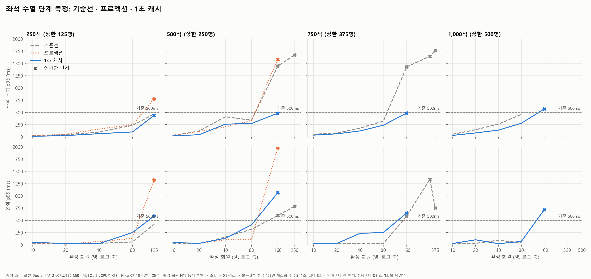

# 좌석 수별 오픈 피크 단계 측정: 기준선 · 프로젝션 · 1초 캐시

측정일 2026-11-01. 모든 수치는 `perf/run.py`로 측정한 값이며, 추정은 그렇게 표시했다. 대상 공연장은 회차당 최대 1,000석이다(ADR 0021). 6,000석 조건의 이전 측정(`report.md`)과는 비교하지 않는다.

## 요약

| 질문 | 답 |
|---|---|
| 개선 전 어디서 무너지나 | 500·750석은 **80명 통과, 160명 실패**. 실패 원인은 **좌석 조회 p95**(약 1.4초)와 커넥션 대기 급증(150ms 이상). 250석은 상한 125명까지 통과했지만 경계에 걸쳐 있다 |
| 1초 캐시 뒤 | 조회 p95가 160명에서도 **484~571ms**로 내려갔다(기준선 1.4초대). 무너지는 지점은 그대로 80~160명이지만, **실패 원인이 선점 p95로 바뀌었다** |
| 프로젝션 단독 효과 | 측정으로 확인하지 못했다. 차이가 실행 간 흔들림(특히 COMMIT 지연)보다 작았다 |
| 시스템 오류(2초 타임아웃) | 캐시 뒤 전 단계 0건. 기준선은 500석 250명 45건, 750석 320·375명 111·177건 |
| 정합성 | 모든 실행에서 위반 0 |
| 다음 병목 | **선점 경로.** 캐시로 조회가 커넥션 줄에서 빠지자, 160명에서 커넥션 대기(100~270ms)의 대부분이 선점이다 |

## 1. 측정 환경과 시나리오

| 항목 | 값 |
|---|---|
| 앱 | 컨테이너 2 vCPU / 850 MiB, `-Xmx512m`, `perf` 프로파일 |
| DB | MySQL 8.4, 2 vCPU / 1 GiB, 버퍼 풀 768M |
| 커넥션 풀 | HikariCP 10 |
| 부하 발생기 | k6, 같은 PC(8코어) |
| 데이터 | 회원 10,000명. 측정 회차의 좌석 250/500/750/1,000석(열당 25석), 워밍업 회차 2,000석 |
| 초기화 | 실행마다 DB 삭제 → 스키마·시드 → 좌석 생성 → `ANALYZE TABLE` → 워밍업(회차 2에 800회) |

**활성 회원 1명의 행동**(ADR 0017): 동시 출발 → 좌석 조회 → 0.5~1초 → 같은 열의 붙은 빈 좌석 2석 무작위 선점 → 409면 재조회 → 0.5~1초 → 다른 붙은 2석, 최대 3회. 결제는 하지 않는다.

**단계 측정**: N_max 탐색 대신 좌석 수마다 10 → 20 → 40 → 80 → 160 → … → 좌석 수/2명을 **한 번씩** 잰다. 판정 기준은 ADR 0017(조회·선점 p95 500ms 이하, 시스템 오류 0건, 정합성 위반 0)이다.

| 측정 | 코드 | 시각 | 멈춤 규칙 |
|---|---|---|---|
| 기준선 | 개선 전 | 11:06~11:54 | 상한까지(1,000석은 160명 직전 앱 기동 실패로 80명까지) |
| 프로젝션 | 좌석·점유 조회를 필요한 컬럼만 DTO로 | 12:02~12:22 | 500석 160명 실패에서 전체 중단 |
| 1초 캐시 | 프로젝션 + 회차별 응답 1초 공유(ADR 0020) | 12:31~13:07 | 좌석 수마다 첫 실패에서 다음 좌석 수로 |

250석 기준선은 같은 날 N_max 탐색 1회차가 10 → 20 → 40 → 80 → 125명을 한 번씩 잰 결과를 쓴다(`peak_ladder_seats0250.csv`). 절차가 단계 측정과 같다.

## 2. 결과



원본: `peak_ladder_seats{0250,0500,0750,1000}{,_projection,_cache}.csv`

### 2.1 좌석 조회 p95 (ms)

| 좌석 | 측정 | 10 | 20 | 40 | 80 | 160 | 그 위 |
|---|---|---|---|---|---|---|---|
| 250 | 기준선 | 22 | 45 | 96 | 236 | — | 125명 466 |
| 250 | 프로젝션 | 20 | 55 | 161 | 249 | — | 125명 **774** |
| 250 | 캐시 | 12 | 27 | 66 | 101 | — | 125명 438 |
| 500 | 기준선 | 24 | 120 | 411 | 341 | **1,446** | 250명 1,672 |
| 500 | 프로젝션 | 34 | 113 | 207 | 336 | **1,579** | |
| 500 | 캐시 | 23 | 44 | 260 | 274 | 484 | |
| 750 | 기준선 | 53 | 77 | 180 | 321 | **1,429** | 320명 1,643 / 375명 1,762 |
| 750 | 캐시 | 37 | 62 | 122 | 239 | 485 | |
| 1,000 | 기준선 | 53 | 147 | 259 | 460 | 미측정 | |
| 1,000 | 캐시 | 31 | 81 | 139 | 279 | **571** | |

### 2.2 선점 p95 (ms)

| 좌석 | 측정 | 10 | 20 | 40 | 80 | 160 | 그 위 |
|---|---|---|---|---|---|---|---|
| 250 | 기준선 | 30 | 22 | 31 | 60 | — | 125명 421 |
| 250 | 프로젝션 | 43 | 15 | 68 | 131 | — | 125명 **1,323** |
| 250 | 캐시 | 52 | 26 | 24 | 252 | — | 125명 **588** |
| 500 | 기준선 | 28 | 22 | 158 | 318 | **599** | 250명 788 |
| 500 | 프로젝션 | 46 | 32 | 105 | 103 | **1,980** | |
| 500 | 캐시 | 46 | 31 | 134 | 408 | **1,063** | |
| 750 | 기준선 | 23 | 26 | 32 | 28 | **585** | 320명 1,340 / 375명 755 |
| 750 | 캐시 | 32 | 28 | 236 | 251 | **650** | |
| 1,000 | 기준선 | 24 | 30 | 95 | 39 | 미측정 | |
| 1,000 | 캐시 | 28 | 103 | 24 | 70 | **718** | |

### 2.3 커넥션 대기 평균 (ms)

| 좌석 | 측정 | 40 | 80 | 160 |
|---|---|---|---|---|
| 500 | 기준선 / 캐시 | 4.2 / 0.2 | 50.8 / 64.2 | 162.5 / 268.9 |
| 750 | 기준선 / 캐시 | 1.0 / 1.9 | 6.9 / 27.9 | 156.1 / 136.5 |
| 1,000 | 기준선 / 캐시 | 13.2 / 0.1 | 18.4 / 0.5 | — / 101.6 |

## 3. 해석

### 3.1 기준선: 조회가 커넥션 줄을 만든다
- 오픈 피크는 N명의 조회가 거의 동시에 도착한다. 커넥션은 10개라, 160명이면 조회만으로 10건씩 16바퀴를 돈다(어림 계산).
- 500석에서 커넥션 사용 평균은 40명 이후 45~58ms로 멈추고, 커넥션 대기만 4 → 51 → 163ms로 는다. 풀이 동시 처리 수를 10으로 막아서 하나하나의 처리 시간은 그대로이고, 늘어난 회원은 풀 바깥 줄로 간다.
- 160명부터 서버 CPU 최대가 100%다. 풀을 늘려도 CPU 2개를 더 잘게 나눌 뿐이라 효과가 작을 것으로 본다(추정).

### 3.2 1초 캐시: 조회가 줄에서 빠지고 선점이 드러난다
- 캐시에 맞은 조회는 커넥션을 빌리지 않는다. 160명에서 조회 p95가 1.4초대에서 0.5초 안팎으로 내려갔다.
- 160명에서도 커넥션 대기는 100~270ms로 크다. 이제 그 줄에 서는 것은 대부분 선점이고, 실패도 선점 p95에서 난다.
- 남은 조회 지연(160명 480~570ms)은 캐시 만료 순간 한 요청이 DB 조회·JSON 생성을 하는 동안 나머지가 기다리는 시간과 CPU 경합으로 본다(추정).
- 409 충돌이 같은 지점에서 대체로 늘었다(예: 500석 80명 13 → 27건, 750석 160명 40 → 52건). 최대 1초 낡은 화면의 대가로, ADR 0020에서 예상한 방향이다. 실행 한 번씩이라 크기는 단정하지 않는다.

### 3.3 프로젝션: 효과를 분리하지 못했다
- 쿼리 기록으로 필요한 컬럼만 SELECT하는 것은 확인했다(좌석 `id, seat_row, seat_no`, 점유 `seat_id, status`).
- 그러나 250·500석에서 기준선과의 차이가 위아래로 섞였다. 코드를 바꾸지 않은 선점 p95까지 같이 흔들렸다.

## 4. 측정의 한계: COMMIT 지연

선점은 COMMIT이 끝날 때까지 좌석 락과 커넥션을 쥔다. COMMIT은 디스크 기록 속도에 좌우되는데, 측정 시각에 따라 크게 달랐다.

| 측정 | COMMIT 평균의 중앙값(실행별) | 큰 값의 예 |
|---|---|---|
| 기준선 (11시대) | 1.6ms | 500석 250명 9.8ms |
| 프로젝션 (12시대) | 3.2ms | 500석 160명 20.4ms, 250석 125명 11.3ms(최대 217ms) |
| 캐시 (12시 반~13시) | 3.5ms | 1,000석 160명 29.2ms, 250석 80명 10.5ms(최대 114ms) |

- 선점 경로의 코드는 세 측정에서 같다. 선점 p95 차이의 상당 부분은 코드가 아니라 **측정 시점의 디스크 상태** 차이로 본다(추정). 원인은 확인하지 못했다.
- 그래서 이 보고서는 **조회 경로 개선(조회 p95, 커넥션 대기)**은 결론으로 쓰고, **선점 p95의 전후 차이**는 결론으로 쓰지 않는다.
- 모든 지점이 한 번씩만 잰 값이다. 단계는 두 배씩 건너뛰므로 N_max는 "80~160명 사이"까지만 말할 수 있다.

## 5. 다음

1. **선점 경로**: 커넥션과 락을 쥐는 시간을 줄인다. 후보는 `hold-query-improvements.md`.
2. **N_max 탐색**: ADR 0017대로 프로젝션·캐시 뒤에 한다. 그 전에 COMMIT 흔들림을 줄이거나, 기준선과 같은 시간대에 연달아 재는 방법을 정한다.
3. **대기열(#20)**: 지금 값이면 500석 이상의 동시 입장은 80명 안팎에서 시작해야 한다.

## 6. 재현

```bash
python perf/run.py ladder --seats 250 500 750 1000   # 단계 측정(상한까지)
python perf/plot.py                                   # ladder-comparison.png
```

프로젝션·캐시 측정은 같은 `run_trial`로 결과 파일 이름에 `_projection`, `_cache`를 붙여 저장했다.
