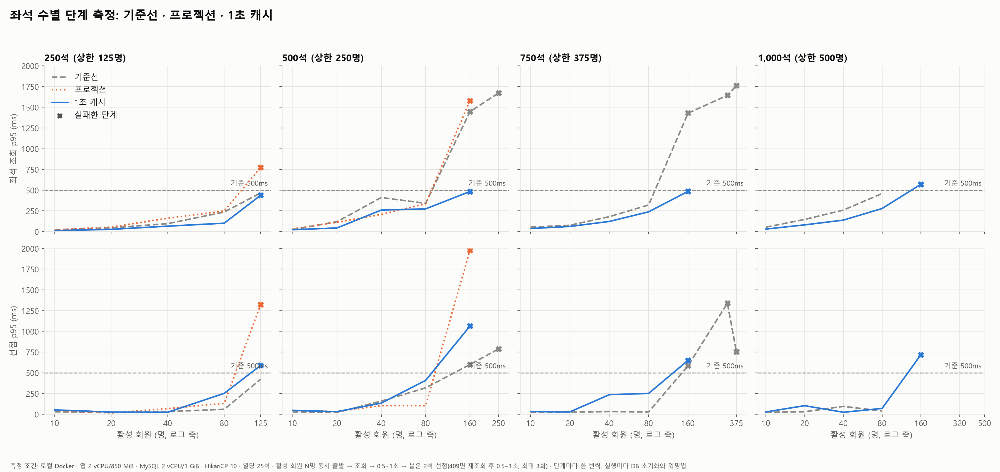

# TicketFlow 개발 이야기: 작은 서버로 선착순 예매를 지키기

> **한 줄 요약**: 한 좌석은 반드시 한 사람에게만 가야 하는 선착순 예매 서비스를 만들고, 서버를 키우지 않은 채 측정 → 원인 확인 → 개선을 반복해 같은 서버가 받을 수 있는 동시 입장 회원을 두 배(80명 → 160명, 단계 측정 기준)로 늘렸다.

| 숫자로 보는 결과 | |
|---|---|
| 정합성 | 모든 부하 측정에서 **좌석 중복 점유 0건, 회원 중복 선점 0건** |
| 500석 회차, 160명 동시 입장 | 좌석 조회 p95 **1,446ms → 295ms**, 선점 p95 **599ms → 349ms**. 품질 기준(500ms) 실패 → **통과** |
| 서버 자원 | 앱·DB 각 2 vCPU, 커넥션 풀 10개. **끝까지 늘리지 않았다** |
| 설계 결정 기록 | ADR 21개 |

---

## 1. 문제: 선착순 예매가 어려운 두 가지 이유

공연 예매가 열리는 순간, 수백 명이 같은 좌석표를 보고 동시에 버튼을 누른다. 이 서비스는 두 가지를 동시에 지켜야 한다.

1. **정확성**: 같은 좌석을 두 사람이 동시에 잡아도 **한 사람만** 성공해야 한다. 회원 한 명은 한 회차에 4석까지만 잡을 수 있다.
2. **버티기**: 요청이 한순간에 몰려도 화면이 멈추지 않아야 한다.

정확성은 타협할 수 없고, 버티기는 서버 자원과의 싸움이다. 이 프로젝트는 정확성을 먼저 확실히 하고, 그 위에서 버티기의 한계를 숫자로 찾아 밀어 올린 기록이다.

회원은 좌석 1~4석을 **5분 동안 선점**하고, 그 안에 결제하면 예매가 확정된다. 결제하지 않으면 선점은 만료되고 좌석은 다시 열린다.

## 2. 1막: 정확성 — 동시에 와도 한 사람만

### 코드보다 경쟁 상황을 먼저 적었다
구현하기 전에 "동시에 일어나면 문제가 되는 상황"을 직접 문서로 정리했다([`concurrency-cases.md`](concurrency-cases.md)).
- 같은 좌석을 두 회원이 동시에 선점한다.
- 같은 회원이 두 탭에서 동시에 선점해 4석 제한을 넘긴다.
- 결제와 선점 만료가 같은 순간에 겹친다.
- 결제와 선점 취소가 동시에 들어온다.

해결책으로 조건부 업데이트, 낙관적 락, 비관적 락을 비교했고, **좌석 행에 거는 비관적 락**을 골랐다([ADR 0008](adr/0008-serialize-seat-occupancy-with-row-locks.md)). 좌석 행은 처음 선점되는 좌석이든 만료된 선점이 남은 좌석이든 항상 존재한다. 그래서 모든 경우를 **한 가지 규칙**으로 막을 수 있었다.

### 규칙 하나로 모든 경합을 줄 세운다
좌석 점유를 바꾸는 모든 작업(선점, 선점 취소, 결제, 예매 취소)은 한 컴포넌트(`SeatOccupancyLock`)에서만 락을 잡는다([ADR 0011](adr/0011-acquire-occupancy-locks-in-one-place.md)).

1. 회원 행을 잠근다. 같은 회원의 두 탭이 서로 다른 좌석을 노려도 여기서 만난다.
2. 좌석 행을 **id 오름차순**으로 잠근다. A3+A4와 A4+A5가 동시에 와도 교착 상태가 생기지 않는다.
3. 락을 잡은 뒤 최신 커밋 값을 다시 읽는다(`READ COMMITTED`). 기본 격리 수준(`REPEATABLE READ`)이면 락을 기다리는 동안 커밋된 다른 선점을 못 볼 수 있기 때문이다.

선점 만료는 정리 작업 없이 **만료 시각과 현재 시각의 비교**로 판단한다. 스케줄러가 늦게 돌아도 5분이 지나면 그 즉시 좌석이 열린다. 시각은 주입된 `Clock`에서 읽어, 테스트에서 시계를 움직여 만료 경계를 재현한다([ADR 0004](adr/0004-datetime-with-injected-clock.md)).

### 실제 MySQL로 동시성을 테스트한다
H2나 Mock 대신 Testcontainers로 실제 MySQL을 띄운다([ADR 0002](adr/0002-mysql-only-no-h2.md), [ADR 0005](adr/0005-test-strategy.md)). 락과 격리 수준의 동작은 DB마다 다르기 때문이다. 여러 스레드가 같은 좌석을 동시에 노리는 동시성 테스트(선점, 선점 취소, 결제, 예매 취소)가 불변식([`invariants.md`](invariants.md))이 지켜지는지 확인한다.

이 설계는 뒤의 모든 부하 측정에서 한 번도 깨지지 않았다.

## 3. 2막: "버틴다"의 기준부터 정했다

"얼마나 버티나"를 재려면 먼저 "버틴다"가 무엇인지 정해야 했다.

- **품질 기준**: 예매 오픈 순간에 좌석 조회와 선점의 p95가 500ms 이하, 시스템 오류 0건, 정합성 위반 0건([ADR 0017](adr/0017-performance-quality-criteria.md)).
- **회원 행동 모델**: 회원 N명이 동시에 들어와 좌석표를 보고, 0.5~1초 고민한 뒤 같은 열의 붙은 2석을 고른다. 이미 누가 잡았으면(409) 다시 보고 다른 자리를 고른다. 최대 3번.
- **N_max**: 이 기준을 지키며 동시에 들여보낼 수 있는 최대 회원 수. 나중에 만들 대기열의 "한 번에 입장시킬 인원"이 된다.

### 첫 측정이 방향을 바꿨다
처음에는 회차당 6,000석으로 쟀다. 결과는 **동시 입장 8명**이었다. 좌석표 응답 하나가 437KB였고, 객체 생성과 GC, 커넥션 점유가 줄줄이 이어졌다.

여기서 선택지는 둘이었다. 서버를 키우거나, 이 서버가 감당할 무대를 다시 정하거나. 6,000석은 대규모 공연장의 규모다. 확장하지 않는 서버로 그 트래픽을 받는 것은 무리라고 판단했다. 대신 **한정된 자원 안에서 받을 수 있는 최대한의 트래픽을 받는다면, 그것이 이 서버에게는 대규모 트래픽**이라고 보고, 대상을 **최대 1,000석의 소극장**으로 좁혔다([ADR 0021](adr/0021-target-venue-up-to-1000-seats.md)). 그리고 250 / 500 / 750 / 1,000석마다 한계를 찾기로 했다.

> **곁가지 발견: 실행계획이 무너지면 동시성이 무너진다**
> 첫 측정에서 서로 다른 좌석을 고른 선점들이 이상하게 줄을 섰다. 추적해 보니 좌석 락 쿼리가 쿼리마다 테이블 전체(10,000행)를 읽고 있었다. 시드 직후 테이블 통계가 `n_rows = 0`으로 남아 옵티마이저가 전체 스캔을 골랐고, `FOR UPDATE` 전체 스캔은 남이 잠근 행을 지날 때마다 멈추므로 모든 선점이 직렬화됐다. `ANALYZE TABLE`로 해결했다. 락을 거는 쿼리는 실행계획이 바뀌면 느려지는 정도가 아니라 동시성 자체가 무너진다는 것을 배웠다.

## 4. 3막: 병목을 하나씩, 측정이 가리키는 곳만

원칙은 하나였다. **추측으로 고치지 않고, 측정이 가리킨 곳만 고친다.** 개선마다 같은 조건(10 → 20 → 40 → 80 → 160명)으로 다시 쟀다([`seat-count-report.md`](performance/seat-count-report.md)).

### ① 기준선: 좌석 조회가 커넥션 앞에 줄을 만든다
500석 160명에서 조회 p95 1,446ms로 실패했다. 커넥션 하나가 일하는 시간은 40명 이후 그대로였고, **커넥션을 기다리는 시간만** 4 → 51 → 163ms로 늘었다. 커넥션 10개 앞에 줄이 생긴 것이다.

### ② DTO 프로젝션: 효과를 증명하지 못했다고 적었다
필요한 컬럼만 읽게 바꿨지만, 전후 차이가 측정할 때마다 생기는 흔들림보다 작았다. 코드를 바꾸지 않은 선점 p95까지 같이 흔들렸다. 원인을 찾아보니 **COMMIT 시간**이 측정 시각에 따라 1.6ms에서 3.5ms(큰 값은 20ms 이상)까지 달랐다. 그래서 프로젝션 효과는 결론에서 뺐고, 이후 보고서에서 선점 p95의 전후 차이를 해석할 때 이 한계를 함께 적었다.

### ③ 1초 캐시: 조회를 줄에서 빼다
같은 회차의 좌석표를 1초 동안 모든 회원이 공유하게 했다([ADR 0020](adr/0020-share-seat-status-with-short-local-cache.md)). 근거는 기술이 아니라 서비스였다. 실제 예매 화면도 좌석 상태가 실시간이 아니고, 좌석을 고른 뒤에야 "이미 선점된 좌석"이라고 알려 준다. 최종 판정은 어차피 선점할 때 락으로 하므로, 1초 늦은 화면은 받아들일 수 있다고 판단했다.
- 결과: 160명 조회 p95 1.4초대 → **0.5초 안팎**.
- 그런데 여전히 실패했다. **이번엔 선점 p95**(1,063ms)였다. 조회가 줄에서 빠지자 그 줄에 서 있던 선점이 드러났다.
- 새로고침하면 내 선점이 1초 동안 안 보이는 문제가 생겨, 화면이 내 선점을 따로 기억하게 했다.

### ④ 선점 커넥션: 숫자가 맞지 않는 곳을 팠다
선점 1건이 DB에서 쓰는 시간은 약 11ms였다. 그런데 커넥션을 쥔 시간은 평균 62ms였다. **DB 밖에서 커넥션을 50ms나 쥐고 있었다.**
1. 단서: 커넥션을 빌린 횟수(240)가 선점 수(237)와 같았다. 선점 요청은 트랜잭션 밖 요청 앞단에서도 회원 존재를 확인하는데, 그렇다면 빌린 횟수는 두 배여야 했다.
2. 가설: OSIV(기본값 켜짐)가 앞단에서 빌린 커넥션을 요청이 끝날 때까지 쥐고 있다.
3. 확인: OSIV를 끄자 빌린 횟수가 **477, 정확히 두 배**가 됐다.
4. 해결: OSIV를 끄고, 선점 API의 앞단 회원 확인을 생략했다. 트랜잭션 안에서 회원 행을 잠그는 조회가 이미 존재 확인을 겸하기 때문이다([ADR 0007](adr/0007-member-id-argument-resolver.md)).

| 500석 · 160명 | 기준선 | 1초 캐시 | + 선점 커넥션 개선 |
|---|---|---|---|
| 좌석 조회 p95 | 1,446ms | 484ms | **295ms** |
| 선점 p95 | 599ms | 1,063ms | **349ms** |
| 커넥션 대기 평균 | 162.5ms | 268.9ms | **50.2ms** |
| 판정 | 실패 | 실패 | **통과** |

같은 서버에서 통과하는 동시 입장 인원이 80명에서 160명으로 올라갔다. 750석 160명도 통과했고, 1,000석 160명은 조회 p95 541ms로 아직 실패한다.

## 5. 4막: 실제 클라우드에서 다시 재기

로컬 측정은 개선 전후를 비교하는 용도였다([ADR 0016](adr/0016-load-test-on-limited-local-containers.md)). 최종 한계는 실제 환경에서 잰다.

- **환경**: AWS EC2 t3.micro(앱) + RDS db.t4g.micro(MySQL), 서울 리전. 측정 전용이고 외부에 공개하지 않는다.
- **부하**: 내 PC의 k6가 인터넷을 거쳐 요청을 보낸다.
- **판정**: 인터넷 구간의 지연이 결과를 흐리지 않도록, **서버가 요청을 받아 응답할 때까지의 시간**(Tomcat 접근 로그)으로 p95를 계산한다. 회원이 체감하는 k6 쪽 시간도 함께 기록한다.
- **자동화**: `python perf/run.py peak --target aws` 한 줄로 DB 초기화, 앱 재시작, 측정, 정합성 검사, 서버 로그 수집까지 돈다([ADR 0019](adr/0019-load-test-automation-with-python.md)).
- **탐색**: 좌석 수마다 10명에서 시작해 두 배씩 늘리고, 실패하면 2명 단위까지 좁힌다. 3번 반복해 가장 낮은 값과 흔들림 폭으로 **안전한 입장 인원**을 정한다.

**결과: 측정 중.** 좌석 수별 N_max와 입장 인원이 나오면 여기에 채운다.

## 6. 일하는 방식

- **문제를 먼저 재현하고 측정한 뒤 고친다.** 캐시도 OSIV도 측정이 가리킨 뒤에야 넣었다.
- **측정한 것과 추정한 것을 나눠 적는다.** 보고서의 추정에는 "(추정)"을 붙였다. 효과를 증명하지 못한 개선(프로젝션)도 그렇게 적었다.
- **결정은 이유와 함께 남긴다.** 고려한 대안과 고른 이유를 ADR 21개로 기록했다. 결정이 바뀌면 ADR을 고친다.
- **기술보다 서비스 기준으로 판단한다.** 1초 캐시는 "예매 화면은 원래 실시간이 아니다", 1,000석 목표는 "이 서버에 맞는 무대"라는 판단에서 나왔다.
- **AI와 함께 만들되, 설계는 직접 정한다.** 구현은 AI 코딩 도구와 함께 했다. 대신 동시성 케이스 문서는 직접 쓰고, 설계와 트레이드오프는 대화로 하나씩 골랐다. AI의 제안은 근거를 듣고 받아들이거나 고쳤다.

## 7. 다음 이야기

| 주제 | 하려는 것 |
|---|---|
| 회원 인증 | 헤더 대신 Spring Security로 회원을 식별하고, 도입 전후 성능을 AWS에서 비교한다 |
| 예매 오픈 대기열 | 측정한 N_max만큼씩 입장시켜, 대기열이 없으면 깨지는 기준이 대기열이 있으면 지켜지는 것을 보인다 |
| 외부 결제 연동 | 결제 대행사 호출을 락 밖으로 빼고, 이중 결제(멱등키)와 결제·DB 불일치(보상 처리)를 다룬다 |
| 인기 좌석 경합과 락 타임아웃 | 한 좌석에 몰릴 때 서비스가 멈추는 지점을 재현하고, 오래 기다리다 실패하지 않게 한다 |
| 서버 여러 대의 시계 | 서버마다 시계가 어긋나도 만료 판정과 4석 제한이 지켜지게 한다 |

## 더 보기

| 문서 | 내용 |
|---|---|
| [`README.md`](../README.md) | 기능, 실행 방법, API |
| [`invariants.md`](invariants.md) | 어떤 동시성에서도 지켜야 하는 규칙 |
| [`concurrency-cases.md`](concurrency-cases.md) | 경쟁 상황 분석과 해결 방식 비교 |
| [`performance/seat-count-report.md`](performance/seat-count-report.md) | 좌석 수별 측정과 개선 보고서 |
| [`adr/`](adr/) | 설계 결정 기록 |
